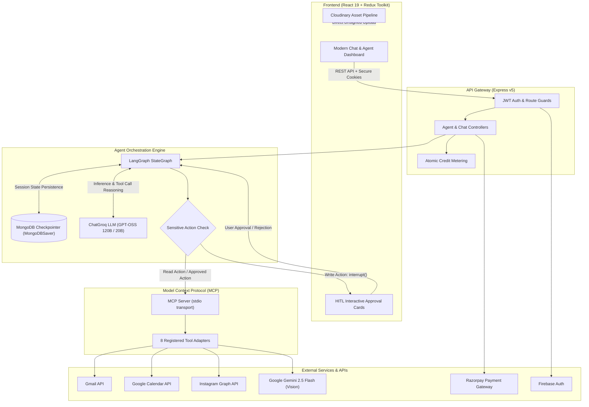
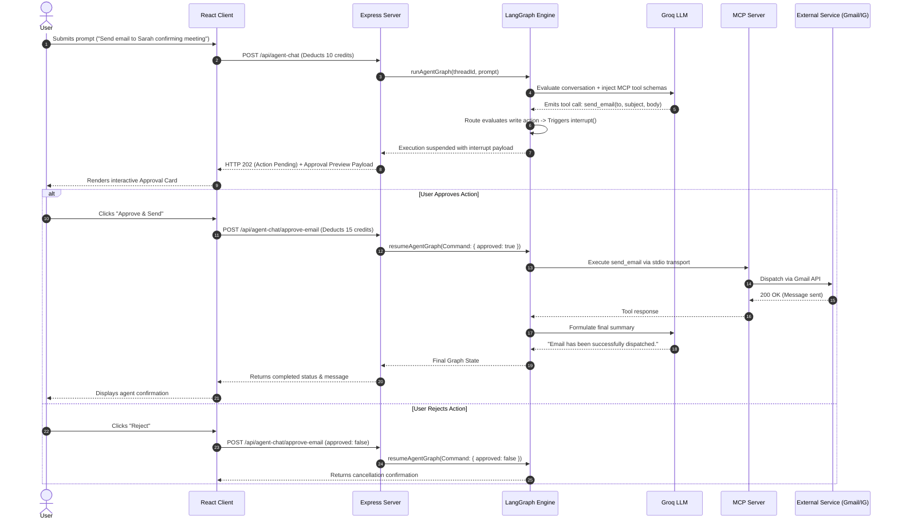

<div align="center">

# 🤖 AutoMate AI

### *Autonomous Multi-Tool Agentic AI Platform with Human-in-the-Loop Guardrails*

[](https://react.dev/)
[](https://langchain-ai.github.io/langgraphjs/)
[-8A2BE2)](https://modelcontextprotocol.io/)
[](https://expressjs.com/)
[](https://www.mongodb.com/)
[](https://groq.com/)
[](https://tailwindcss.com/)
[](https://opensource.org/licenses/MIT)

<p align="center">
  A production-ready, full-stack Agentic AI SaaS platform that allows users to create, customize, and deploy autonomous AI agents capable of executing real-world tasks across Gmail, Google Calendar, and Instagram — fortified with Model Context Protocol (MCP), LangGraph graph-based orchestration, and Human-in-the-Loop (HITL) approval mechanics.
</p>

[Key Features](#-key-features) • [System Architecture](#-system-architecture) • [Tech Stack](#-tech-stack) • [Getting Started](#-getting-started) • [Challenges & Solutions](#-challenges-faced-and-solutions) • [Author](#-author)

</div>

---

## 🌟 Executive Overview

**AutoMate AI** bridges the gap between passive conversational LLMs and actionable, autonomous agents. Unlike typical chatbots that only respond with text, AutoMate AI agents interact with external APIs to read and send emails, manage schedules, analyze visual media, and publish content to social platforms.

To ensure production safety and user trust, AutoMate AI implements a **Human-in-the-Loop (HITL)** architecture. The system intelligently detects sensitive external mutations (such as dispatching an email or publishing an Instagram post), pauses execution at the graph level, renders an interactive approval card in the client, and only resumes upon explicit user authorization.

---

## 🏗️ System Architecture



---

## 🔄 Interaction & Execution Workflow



---

## ✨ Key Features

### 1. 🤖 Custom AI Agent Builder
- **Configurable Personas:** Define custom system instructions, behavioral guidelines, and system prompts.
- **Dynamic Model Selection:** Choose between `openai/gpt-oss-120b` (complex multi-step reasoning) and `openai/gpt-oss-20b` (low-latency execution) via Groq Cloud.
- **Granular Tool Permissions:** Toggle specific capabilities per agent (Email reading/sending, Calendar scheduling, Social publishing, Vision analysis).

### 2. 🛡️ Human-in-the-Loop (HITL) Safety Engine
- Protects users against destructive or irreversible actions.
- Uses LangGraph's native `interrupt()` and `Command({ resume })` primitives.
- Actions requiring approval:
  - **Email Operations:** Sending new messages or dispatching replies.
  - **Calendar Scheduling:** Creating, moving, or modifying calendar events.
  - **Social Media Publishing:** Publishing images and captions to Instagram.
- Multi-tier safety guards with regex intent verification to prevent accidental publication.

### 3. 🔌 Native Model Context Protocol (MCP) Architecture
- Fully modular tool ecosystem built on the official Model Context Protocol standard (`@modelcontextprotocol/sdk`).
- Runs in an isolated `stdio` child-process layer, cleanly separating agent logic from execution tooling.
- Tools included out-of-the-box:
  - `send_email`: RFC 2822 email construction and dispatch via Gmail API.
  - `list_emails` & `read_email`: Search and read messages with base64 payload decoding.
  - `create_calendar_event` & `list_calendar_events`: Google Calendar event scheduling and querying.
  - `publish_instagram_image`: Multi-stage container creation, async transcode polling, and publication.
  - `analyze_image`: Multimodal visual inspection using Google Gemini 2.5 Flash.
  - `get_current_time`: Precise UTC temporal context injection.

### 4. 🔐 Enterprise-Grade Security & OAuth2 Management
- **AES-256-GCM Encryption:** All third-party access and refresh tokens are encrypted at rest with distinct 12-byte initialization vectors (IV) and authentication tags (`iv:authTag:ciphertext`).
- **Token Isolation:** Sensitive database fields are marked with `select: false` by default in Mongoose schemas.
- **Secure Sessions:** Firebase Authentication paired with HTTP-only, SameSite JWT session cookies.

### 5. 💳 Credit-Based Monetization & Razorpay Integration
- Freemium onboarding model granting 100 complimentary credits upon registration.
- Atomic balance deductions using MongoDB `$inc` with `$gte` guards to eliminate race conditions.
- Tiered purchase plans (Pro: ₹299 / 500 credits, Team: ₹799 / 2000 credits).
- Razorpay webhook verification with timing-safe cryptographic signature comparison.

---

## 🛠️ Tech Stack

| Category | Technology | Purpose |
|---|---|---|
| **Frontend Framework** | React 19 (Vite 8.3) | High-performance single page application |
| **State Management** | Redux Toolkit | Centralized state for user session and active agent |
| **UI & Styling** | Tailwind CSS v4, shadcn/ui | Modern, responsive dark-mode interface |
| **Icons & Feedback** | Lucide React, Sonner | UI iconography and toast notification system |
| **Backend Framework** | Node.js, Express v5 (ESM) | Core REST API gateway |
| **Database & ODM** | MongoDB, Mongoose v9 | Persistent document and user store |
| **Agent Orchestration**| LangGraph.js (`@langchain/langgraph`) | StateGraph orchestration, interrupts, routing |
| **Agent Persistence** | `@langchain/langgraph-checkpoint-mongodb` | Multi-turn conversational session checkpointer |
| **LLM Inference** | Groq Cloud (`@langchain/groq`) | Ultra-fast inference with open-weight models |
| **Multimodal Vision** | Google Gemini 2.5 Flash (`@google/genai`) | High-fidelity image parsing and description |
| **Tool Protocol** | Model Context Protocol (`@modelcontextprotocol/sdk`) | Standardized tool exposure via stdio transport |
| **Authentication** | Firebase Admin SDK, JWT | Google OAuth login and secure session validation |
| **Integrations** | Google APIs (`googleapis`), Instagram Graph API | Gmail, Calendar, and Instagram automations |
| **Payments** | Razorpay SDK | Order creation, payment processing, signature verification |
| **Asset Storage** | Cloudinary | Fast, unsigned image hosting for visual workflows |

---

## 📂 Project Directory Structure

```text
agentic-ai-project/
├── backend/
│   ├── config/               # Database, Firebase, OAuth, and Razorpay configs
│   │   ├── db.js
│   │   ├── firebase.js
│   │   ├── googleOAuth.js
│   │   ├── langgraph-checkpointer.js
│   │   └── razorpay.js
│   ├── controllers/          # Business logic handlers
│   │   ├── agent.controller.js
│   │   ├── agentChat.controller.js
│   │   ├── auth.controller.js
│   │   ├── integration.controller.js
│   │   └── payment.controller.js
│   ├── mcp/                  # Model Context Protocol implementation
│   │   ├── client.js         # Debug & diagnostic client
│   │   ├── langgraph-mcp.js  # Bridge connecting MCP to LangGraph
│   │   └── server.js         # 8 registered production tools (stdio transport)
│   ├── middleware/           # Protected route middleware & JWT verification
│   ├── models/               # Mongoose Schemas (User, Agent, Integration, Payment)
│   ├── routes/               # Express route declarations
│   ├── services/
│   │   └── agentGraph.service.js  # Core LangGraph StateGraph & HITL logic
│   ├── utils/                # Encryption (AES-256-GCM) and credit deduct logic
│   ├── index.js              # Server entry point
│   └── package.json
│
├── frontend/
│   ├── public/               # Public assets and favicon
│   ├── src/
│   │   ├── components/       # Reusable UI widgets & forms (shadcn/ui)
│   │   ├── features/         # Modular API service hooks
│   │   ├── hooks/            # Custom React hooks (useFetchMe)
│   │   ├── pages/            # View pages (Home, Agents, CreateAgent, Integration, Pricing, Login)
│   │   ├── redux/            # Store and user state slices
│   │   ├── App.jsx           # Client router & auth boundary
│   │   └── main.jsx          # React DOM entry
│   └── package.json
└── README.md
```

---

## 🚀 Getting Started

### Prerequisites
- **Node.js**: v18.x or higher
- **MongoDB**: Local instance or MongoDB Atlas URI
- **API Keys Required**:
  - [Groq Cloud API Key](https://console.groq.com/)
  - [Google Gemini API Key](https://aistudio.google.com/)
  - [Firebase Project & Service Account](https://firebase.google.com/)
  - [Google Cloud Console Credentials](https://console.cloud.google.com/) (Gmail & Calendar scopes enabled)
  - [Meta for Developers App](https://developers.facebook.com/) (Instagram Graph API)
  - [Razorpay Account](https://razorpay.com/) (Key ID and Secret)
  - [Cloudinary Account](https://cloudinary.com/) (Unsigned upload preset)

---

### Backend Setup

1. **Navigate to the backend directory:**
   ```bash
   cd backend
   ```

2. **Install dependencies:**
   ```bash
   npm install
   ```

3. **Configure Environment Variables:**
   Create a `.env` file in `backend/`:
   ```env
   PORT=5000
   NODE_ENV=development
   CLIENT_URL=http://localhost:5173

   # Database
   MONGODB_URI=mongodb+srv://<username>:<password>@cluster.mongodb.net/automate_ai

   # Security
   JWT_SECRET=your_super_secret_jwt_key
   ENCRYPTION_KEY=64_character_hex_string_for_aes_256_gcm

   # LLM & Vision
   GROQ_API_KEY=gsk_your_groq_api_key
   GEMINI_API_KEY=your_gemini_api_key

   # Google OAuth
   GOOGLE_CLIENT_ID=your_google_client_id.apps.googleusercontent.com
   GOOGLE_CLIENT_SECRET=your_google_client_secret
   GOOGLE_CALLBACK_URL=http://localhost:5000/api/integrations/google/callback

   # Instagram OAuth
   INSTAGRAM_APP_ID=your_meta_app_id
   INSTAGRAM_APP_SECRET=your_meta_app_secret
   INSTAGRAM_REDIRECT_URI=http://localhost:5000/api/integrations/instagram/callback

   # Razorpay
   RAZORPAY_KEY_ID=rzp_test_your_key_id
   RAZORPAY_KEY_SECRET=your_razorpay_secret

   # Firebase Admin
   FIREBASE_SERVICE_ACCOUNT_KEY=./serviceAccountKey.json
   ```

4. **Add Firebase Service Account:**
   Place your downloaded Firebase admin credentials at `backend/serviceAccountKey.json`.

5. **Start the backend server:**
   ```bash
   npm run dev
   ```

---

### Frontend Setup

1. **Navigate to the frontend directory:**
   ```bash
   cd frontend
   ```

2. **Install dependencies:**
   ```bash
   npm install
   ```

3. **Configure Environment Variables:**
   Create a `.env` file in `frontend/`:
   ```env
   VITE_BACKEND_URL=http://localhost:5000
   VITE_FIREBASE_API_KEY=your_firebase_web_api_key
   VITE_FIREBASE_AUTH_DOMAIN=your_project.firebaseapp.com
   VITE_FIREBASE_PROJECT_ID=your_project_id
   VITE_FIREBASE_STORAGE_BUCKET=your_project.appspot.com
   VITE_FIREBASE_MESSAGING_SENDER_ID=your_sender_id
   VITE_FIREBASE_APP_ID=your_app_id
   VITE_CLOUDINARY_CLOUD_NAME=your_cloud_name
   VITE_CLOUDINARY_UPLOAD_PRESET=your_unsigned_preset
   VITE_RAZORPAY_KEY_ID=rzp_test_your_key_id
   ```

4. **Start the development server:**
   ```bash
   npm run dev
   ```

5. Open your browser and navigate to `http://localhost:5173`.

---

## ⚡ Challenges Faced and Solutions

### 1. Human-in-the-Loop (HITL) State Persistence Across Asynchronous HTTP Boundaries
- **The Challenge:** LLM agent graphs execute sequentially, but real-world write actions (dispatching an email, creating calendar events, posting on social media) require human review. Traditional workflows require awkward polling or loss of execution context between client and server.
- **The Solution:** Implemented LangGraph's native `interrupt()` pattern coupled with `MongoDBSaver` checkpointer. When a sensitive tool is invoked, the execution freezes its state into MongoDB and responds with an HTTP 202 status containing the pending action preview. The frontend renders an approval card, and when the user clicks "Approve", the server resumes the exact node state using `Command({ resume: { approved: true } })`.

### 2. Protocol-Driven Tooling via Model Context Protocol (MCP)
- **The Challenge:** Hardcoding tool calls directly into application code tightly couples provider logic with agent prompts, leading to brittle codebases and messy security handoffs.
- **The Solution:** Decoupled all integrations into a standalone Model Context Protocol (MCP) server communicating through `stdio`. Created an adapter bridge in LangGraph that registers MCP tools dynamically and securely injects user-scoped JWT tokens during invocation, guaranteeing that agents only access credentials belonging to the active user.

### 3. Asynchronous Two-Stage Instagram Graph Publishing
- **The Challenge:** Instagram's Graph API does not support direct instantaneous media publishing. It requires uploading to a media container, waiting for Meta's servers to asynchronously transcode and validate the asset, and then issuing a subsequent publish request. Calling publish too early results in fatal failures.
- **The Solution:** Engineered a resilient polling mechanism within the `publish_instagram_image` tool. The MCP tool initializes container creation, checks status codes periodically with exponential backoff, and completes the publication only after Meta returns a `FINISHED` status code.

### 4. Zero-Leakage Token Storage for Multi-Provider OAuth
- **The Challenge:** Managing long-lived refresh tokens and access tokens across Google and Facebook/Instagram in a single database poses significant security risks if stored in plaintext or exposed during basic queries.
- **The Solution:** Implemented authenticated AES-256-GCM symmetric encryption. Each token payload is encrypted with a unique 12-byte initialization vector and an authentication tag to prevent tampering. Additionally, Mongoose schemas enforce `select: false` on credential fields, ensuring tokens are decrypted strictly on-demand within tool execution boundaries.

---

## 🔮 Upcoming Features

- [ ] **Multi-Agent Swarm Collaboration:** Hierarchical supervisor-worker agent graphs where specialized agents (e.g., Researcher Agent, Copywriter Agent, Publisher Agent) collaborate autonomously.
- [ ] **RAG & Custom Knowledge Bases:** Retrieval-Augmented Generation leveraging vector databases (Pinecone / Qdrant) to allow agents to ground actions in uploaded enterprise documentation.
- [ ] **Additional MCP Tool Ecosystem:** Native MCP modules for Slack, Notion, GitHub, and Jira workflows.
- [ ] **Automated Cron & Webhook Triggers:** Enabling agents to execute tasks on recurring schedules (e.g., daily schedule briefings) or in response to external webhooks.
- [ ] **Voice-Driven Actions:** Native speech-to-action integration using OpenAI Whisper and real-time streaming audio responses.

---

## 🏆 Key Highlights

- **Production-Grade Agentic Architecture:** Transcends simple text wrappers by orchestrating multi-step, tool-augmented workflows with graph-level control.
- **Industry Standard Protocols:** Early implementation of Anthropic's **Model Context Protocol (MCP)**, ensuring standard tool portability and security.
- **Comprehensive Full-Stack Implementation:** End-to-end engineering spanning modern frontend UI, distributed backend services, asynchronous tool execution, and monetization.
- **Safety-First Engineering:** Robust Human-in-the-Loop approval workflows and multi-layered safety filters guarantee that autonomous agents never execute irreversible actions without explicit consent.

---

## 👨‍💻 Author

**Sushant**

🎓 Computer Science & Engineering @ Delhi Technological University (DTU)  
💡 Passionate about building high-performance, developer-first tooling and scalable ecosystems.

---

<div align="center">
  <sub>If you find this project useful, please consider giving it a ⭐ on GitHub!</sub>
</div>

